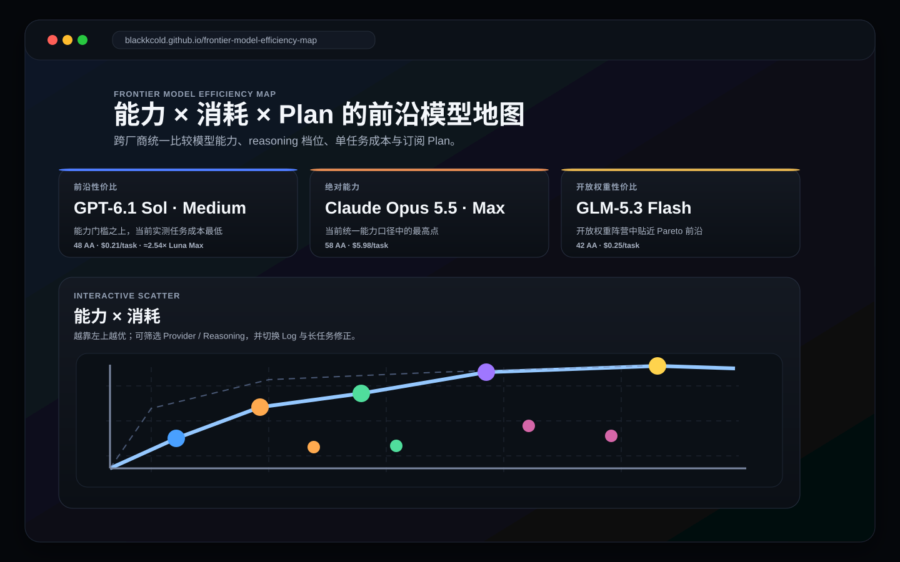
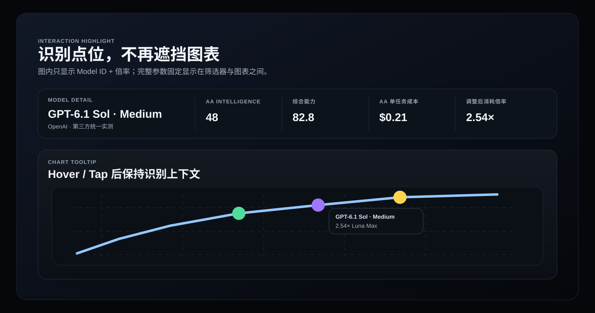

<p align="center">
  
</p>

<h1 align="center">Frontier Model Efficiency Map</h1>

<p align="center">
  把 <strong>模型能力 × Reasoning 档位 × 单任务消耗 × 订阅 Plan</strong> 放到同一张交互地图里。
</p>

<p align="center">
  <a href="https://blackkcold.github.io/frontier-model-efficiency-map/"><strong>Open Live Map ↗</strong></a>
  ·
  <a href="#怎么读这张图">How to read</a>
  ·
  <a href="#方法论">Methodology</a>
  ·
  <a href="LICENSE">MIT</a>
</p>

<p align="center">
  Data snapshot: <strong>2026-10-15</strong> · 7 providers · AA v4.3.2 · No tracking
</p>

---

## 先看体验

<p align="center">
  <a href="https://blackkcold.github.io/frontier-model-efficiency-map/">
    
  </a>
</p>

这不是一个“模型排行榜”，而是一张**决策地图**：

- 顶部三张卡片直接给出当前的 **前沿性价比 / 绝对能力 / 开放权重性价比**。
- 主图把能力放在纵轴、任务消耗放在横轴，**越靠左上越优**。
- Provider、Reasoning 档位、Log 横轴、估算点、历史模型都可以即时筛选。
- 排名表、Plan 推荐与方法论继续向下展开，不需要在多个 benchmark 页面之间来回切换。

> 当前前沿性价比推荐：**GPT-6.1 Sol · Medium**。  
> 当前绝对能力最高点：**Claude Opus 5.5 · Max**。

## 交互细节

<p align="center">
  
</p>

图表交互刻意做得更克制：

- **外观设置**：右上角可选择「浅色 / 深色 / 跟随系统」；本地保存偏好，系统模式会响应系统配色变化；图表、卡片与数据表同步调整。
- **Hover / 点击 / 触摸模型点**：图内只保留 `Model ID + 消耗倍率`，避免 tooltip 挡住附近点。
- **完整详情固定显示**在筛选器与图表之间，包括 AA Intelligence、归一化能力、AA 单任务成本、修正后倍率、实测 / 估算状态。
- 点击后信息保持，手机端也不依赖 hover；如果筛选条件把当前模型隐藏，详情会自动清空。

## 当前覆盖

| Provider | 当前模型族 |
| --- | --- |
| OpenAI | GPT-6 Luna · GPT-6.1 Sol · GPT-6 Astra · GPT-6 Sol（历史） |
| Anthropic | Claude Haiku 5.5 · Claude Sonnet 5.5 · Claude Opus 5.5 · Claude Fable 5.1 |
| Google | Gemini 3.8 Flash · Gemini 4 Argon |
| DeepSeek | DeepSeek V4.1 Flash |
| Z.ai | GLM-5.3 · GLM-5.3 Flash |
| Kimi | Kimi K3 |
| Xiaomi | MiMo V2.6 Pro · MiMo V2.6 Flash（AA 实测）；Pro UltraSpeed（独立服务档，非 AA 实测点） |

### 当前快照的三个锚点

| 目标 | 推荐 | AA Index | AA task cost | 备注 |
| --- | --- | ---: | ---: | --- |
| 前沿性价比 | **GPT-6.1 Sol · Medium** | 48 | $0.21 | 能力门槛之上的最低实测任务成本 |
| 绝对能力 | **Claude Opus 5.5 · Max** | 58 | $5.98 | 当前页面统一能力口径最高点 |
| 开放权重性价比 | **MiMo V2.6 Pro** | 46 | $0.13 | AA 实测，能力高且成本低于原 GLM-5.3 Flash 推荐 |

## 怎么读这张图

### 1. 纵轴：能力

默认使用 **Artificial Analysis Intelligence Index v4.3.2**，并把当前最高点线性归一为 100：

```text
normalized capability = AA Intelligence Index / 58 × 100
```

这样不同 Provider 不需要混用各自的厂商 benchmark。

### 2. 横轴：单任务消耗

默认使用 Artificial Analysis 的 **Cost per Intelligence Index Task**，再以 GPT-6 Luna Max 作为 1× 基准：

```text
consumption ratio = corrected task cost / corrected GPT-6 Luna Max task cost
```

跨厂商的 ChatGPT allowance、Claude session cap、Kimi credits 等内部额度并不等价，所以主图不直接把订阅额度强行换算到同一条轴上。

### 3. 长 Agent 修正

AA 的 task cost 已包含 reasoning token；页面额外提供一个**可关闭的长任务修正层**，用于近似持续 Agent loop 的订阅额度体感：

| Effort | 修正 |
| --- | ---: |
| Low | 1.00× |
| Medium | 1.00× |
| High | 1.05× |
| XHigh | 1.10× |
| Max | 1.18× |

它不是厂商官方计费倍率。

## 数据可信度

页面把三类信息明确区分：

**官方信息**  
用于确认模型是否存在、Reasoning / Effort 档位、订阅 Plan、价格、额度和产品政策。

**统一第三方实测**  
Artificial Analysis 用于跨厂商能力与单任务成本的统一比较。

**显式估算**  
只有在“官方确认该档位存在、但当前 AA 没有对应统一测量”时才补点；UI 使用叉形空心点，并允许一键隐藏。

当前估算点包括 Gemini 3.8 Flash Low、DeepSeek V4.1 Flash Low / High、GLM-5.3 High、Kimi K3 High。

## 方法论

“前沿性价比”不是简单做 **能力 ÷ 价格**。极便宜但能力明显偏低的模型会在这种公式里被数学性放大，因此本项目采用：

1. 先设能力门槛：当前为 **AA Index ≥ 48**；
2. 再在满足门槛的实测点中寻找最低任务成本；
3. 估算点不参与“最高能力”结论；
4. Plan 推荐与 API task cost 分开处理。

这让推荐更接近“这个模型能不能完成目标任务，以及完成它要消耗多少资源”。

## 2026-10-15 小米 MiMo V2.6 与主题升级

- **MiMo V2.6（官方 9/22 发布）**：新增 Xiaomi 第七家 Provider；AA 独立实测 MiMo V2.6 Flash（AA Index **38**，**$0.06/task**）及 Pro（**46**，**$0.13/task**）。两者只设置 `Default`，因为官方虽允许传入 `reasoning.effort`，但实际仅支持开启或关闭深度思考，无法将 low/medium/high/xhigh/max 当作独立推理强度。**不人为插值生成未测试的档位**。[AA 实测](https://artificialanalysis.ai/models/comparisons/mimo-v2-6-flash-vs-mimo-v2-6-pro) · [官方推理参数](https://mimo.mi.com/docs/en-US/api/chat/responses)
- **Pro UltraSpeed**：官方提供最高 **20× 输出速度**，API 海外实时输入 **$4.35/M**、输出 **$8.70/M**（普通 Pro 的 10×）；无独立 AA 单任务能力和成本测量，因此仅在模型说明区披露，不创建虚构的数据点。[官方 API 价格](https://mimo.mi.com/docs/pricing)
- **模型生命周期**：MiMo V2.5-Pro / V2.5 自 10/14 起自动路由至 V2.6 Pro / Flash，旧 ID 将于 **2026-10-21 10:00（北京时间）** 停用。[官方文档](https://mimo.mi.com/docs/en-US)
- **Token Plan**：加入 Lite（$6 / ¥39；4.1B Credits）、Standard（$16 / ¥99；11B）、Pro（$50 / ¥329；38B）、Max（$100 / ¥659；82B）。这些属于编码场景订阅，不与按量 API 余额通用。[官方方案](https://mimo.mi.com/docs/zh-CN/tokenplan)
- **推荐模型更新**：开放权重性价比由 GLM-5.3 Flash（42 / $0.25）改为 MiMo V2.6 Pro（46 / $0.13），原前沿性价比 GPT-6.1 Sol Medium 与绝对能力 Claude Opus 5.5 Max 不变。原有 Plan 推荐不变，新增 MiMo 四个 Plan 供对比，暂不跨厂商换算 Credits 为使用次数。
- **浅色主题**：新增「浅色 / 深色 / 跟随系统」设置，并可持久化选择；图表轴、标签、表格与 hover 同步适配浅色背景。

## 2026-10-12 官方政策补录（AA 实测值沿用 10/10 快照）

- **OpenAI GPT-6.1 Sol Ultrafast（10/8）**：这是 GPT-6.1 Sol 的低延迟服务档位，**不是新模型或新 reasoning 档位**。官方 API 定价 $12/M input、$60/M output，为 Standard 的 6×；不能把官方最高可达 8× 速度提升当作能力分数。Work / Codex 仅 Pro $500、符合条件的 Enterprise / Edu 支持；Pro $500 内含使用量按 Standard 的 8× 扣减，额度用尽后 credits 按 Standard 的 6× 扣减。Plus、Pro $100/$200 和 Business 暂不支持（购买 credits 也不解锁）。对应第三方 AA 能力/单任务成本数据未改变，**不新增虚构的 Ultrafast 测试点**。[官方产品文档](https://developers.openai.com/api/docs/models/gpt-6.1-sol) · [官方 Work/Codex 用量政策](https://help.openai.com/en/articles/20001516-managing-usage-with-gpt-6-astra-in-work-and-codex) · [官方推出公告](https://community.openai.com/t/ultrafast-is-rolling-out-today-for-gpt-6-1-sol-in-the-api-codex-and-chatgpt-work/1404475)
- **Google Gemini API 生命周期（10/8）**：`gemini-3.7-flash` 已弃用并自动路由至 `gemini-3.8-flash`，`gemini-3.5-flash` 已弃用并自动路由至 `gemini-3.6-flash`；`deep-research-pro-preview-12-2025` 已弃用，计划 **10/23 停止服务**，应迁移至 `deep-research-preview-04-2026` 或 `deep-research-max-preview-04-2026`。当前图表未包含上述已弃用旧型号，故不新增对比点。[官方 Gemini API release notes](https://ai.google.dev/gemini-api/docs/changelog)
- **推荐未调整**：前沿性价比仍为 GPT-6.1 Sol · Medium，绝对能力为 Claude Opus 5.5 · Max；订阅 Plan 推荐不变。Ultrafast 的速度、购买资格与额度消耗单独披露，不得混入同一 AA 成本/能力坐标。

## 2026-10 快照变化

- **Google AI Ultra（已于 2026-05 宣布，本次修正旧快照）**：不再是单一 $249.99/月；美国官网现列 **Ultra 5x $99.99/月**、**Ultra 20x $199.99/月**，分别提供约 AI Pro 的 5x / 20x Gemini App 与 Antigravity 用量。Google AI Plus 为 $4.99/月、Google AI Pro 为 $19.99/月（美国官网月价）。
- **Gemini App 个人账号（2026-10-09 起逐步实施）**：Google 专项通知列出 Free 手动可选 Flash-Lite；AI Plus 可选 Flash-Lite / Flash、不再提供手动 Pro；AI Pro 与 Ultra 可选 Flash-Lite / Flash / Pro。AI Plus 生效时间由 Google 单独邮件通知。*通用帮助页仍描述 Auto 自动模型路由/动态访问，故“手动不可选”不等于证明后台绝不使用高级模型；此限制也不等同 Gemini Developer API 政策。*
- **Gemini reasoning 档位**：官方 Gemini App 帮助文档列出 Low / Medium / High，可手动选择时由账户权限与模型决定。高 thinking level 可能占用更多订阅额度；这是 **Gemini App 产品设置**，未当作独立的 API 模型 benchmark 点。<https://support.google.com/gemini/answer/18648722?hl=en>
- **来源**：[Google AI 订阅官网](https://gemini.google.com/advanced) · [Google 2026 I/O 官方公告](https://blog.google/products-and-platforms/products/google-one/google-ai-subscriptions/) · [Google Gemini 访问政策](https://support.google.com/gemini/answer/17004136?hl=en) · [通用额度文档](https://support.google.com/gemini/answer/16275805?hl=en)

- **Claude Haiku 5.5（10/7）**：新增 Low / Medium / High / XHigh / Max 五个 AA 实测点；AA Index 29 → 43，AA task cost $0.02 → $0.21。官方定价（≤100K prompt）为 $0.10/M input、$0.50/M output、$0.01/M cache read。
- **Claude Sonnet 5.5（10/7）**：Anthropic 将 cache read 从 $0.20/M 下调到 $0.10/M；按当前 AA 统一口径刷新后，Low / Medium / High / XHigh / Max task cost 约为 $0.35 / $0.48 / $0.88 / $2.01 / $5.46。
- **Claude Max / Team（10/7）**：Max 5x / 20x 新增 $100 / $200 每月 Claude Platform API credit；Team 按席位发放并共享池化，最高 $500/月。该 credit 不能用于 Claude 或 Claude Code 的额外交互用量。
- **GPT-6 in ChatGPT（10/7）**：Plus / Pro / Business / Enterprise 的 Chat 默认进入 GPT-6 Sol；Pro 的 Pro reasoning 继续使用 GPT-6 Astra。Work / Codex 模型未因这次 Chat 发布而替换。
- **OpenAI Pro policy**：Pro 200 已重新开放新订阅；官方同时注明非 grandfathered 的新 Pro 订阅内含用量低于旧档。Pro 500 仍是唯一包含 Astra Ultrafast 的自助 Pro 档。
- **Claude Fable 5.1**：继续保留当前实测前沿点。
- **Gemini 4 Argon**：继续以 limited rollout / preview 状态纳入，不视为全面可用。
- **GPT-6 Sol**：保留历史对比，但默认隐藏，由 GPT-6.1 Sol 取代当前位置。

**推荐结论未变化**：前沿性价比仍为 **GPT-6.1 Sol · Medium**；绝对能力仍为 **Claude Opus 5.5 · Max**。原有跨厂商 Plan 推荐不变；Google 的新 Ultra 5x 现在提供介于 AI Pro 与最高 Ultra 之间的重度使用选项。Claude Max 新增 API credit 价值仍保留。

更完整的来源链接在网页的 **Methodology & Sources** 区域以及 `data.js` 中。

## 本地运行

这是纯静态站点，不需要构建步骤：

```bash
python3 -m http.server 8000
```

然后打开 `http://localhost:8000`。

## Project

- Live site: https://blackkcold.github.io/frontier-model-efficiency-map/
- License: [MIT](LICENSE)
- Contribution: [CONTRIBUTING.md](CONTRIBUTING.md)
- Security: [SECURITY.md](SECURITY.md)
- Validation: `Static validation`
- Deployment: GitHub Pages
- Governance: CODEOWNERS + protected `main`

---

<p align="center">
  <sub>Static site · No analytics · No tracking · Built for GitHub Pages</sub>
</p>
